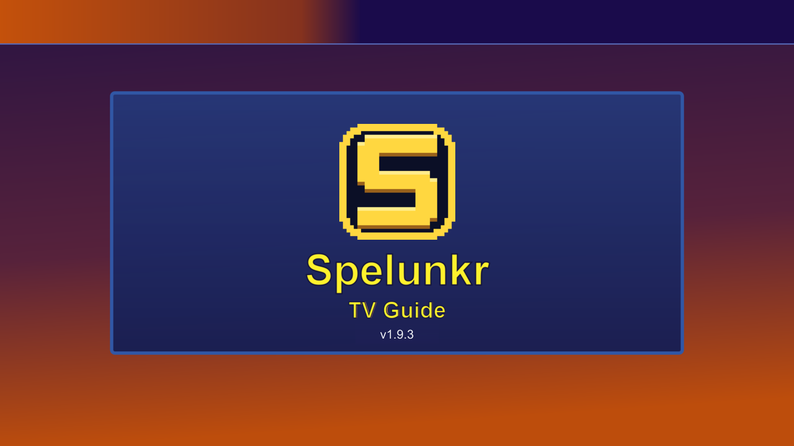
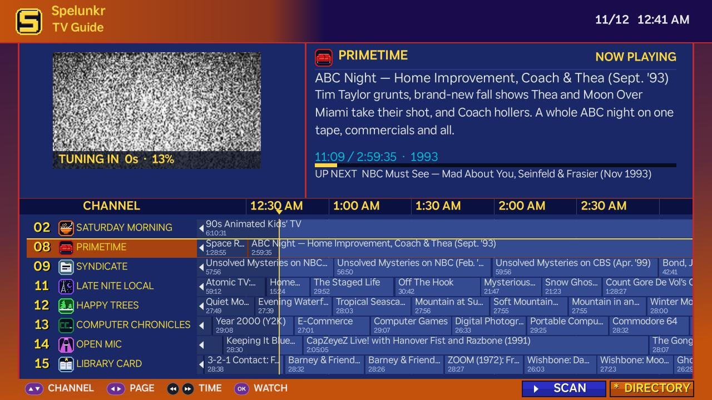
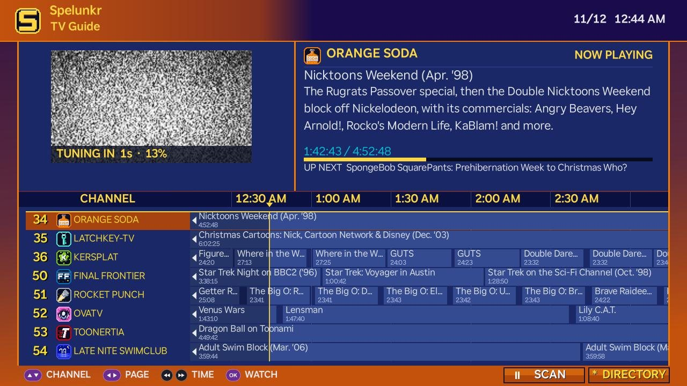
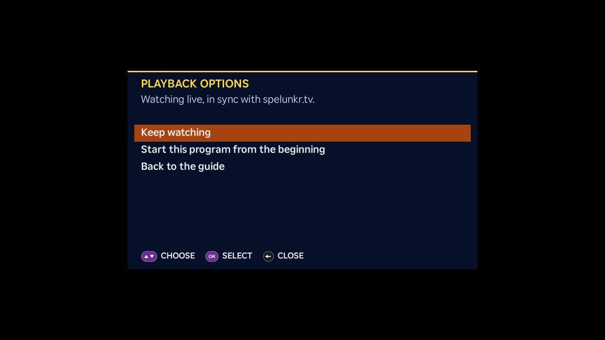
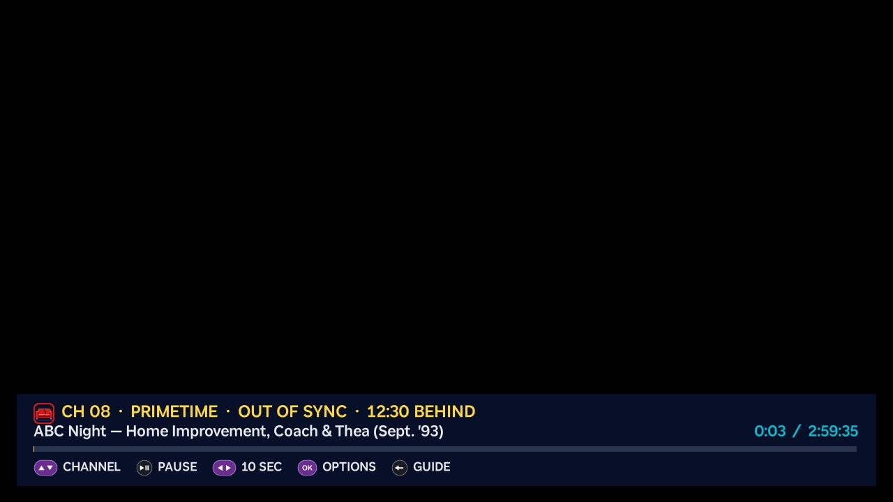
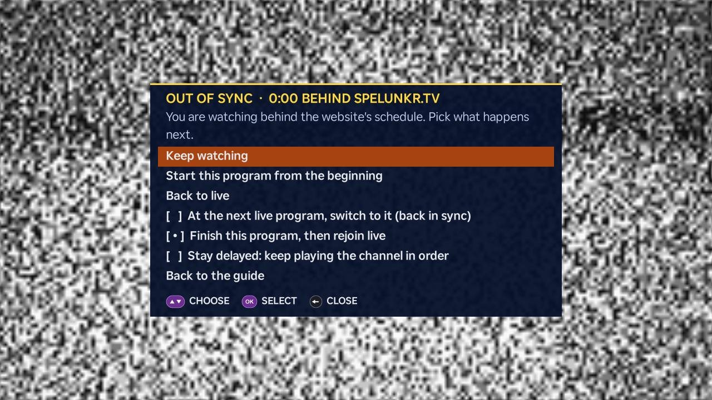

<h1 align="center">Spelunkr TV Guide</h1>

<strong>Unofficial Roku app for the Spelunkr live channel lineup</strong>

Scrolling live guide · Scan · Live preview · Channel directory · Version 1.9.2

> **Unofficial app.** Spelunkr TV Guide for Roku is an independent, fan-made client. It is not made, endorsed or supported by [Spelunkr](https://spelunkr.tv/). Channel names, logos, descriptions and schedules belong to Spelunkr and its sources, and are read from Spelunkr's public guide data while the app runs.

Spelunkr TV Guide puts [Spelunkr](https://spelunkr.tv/)'s always-on retro channels on your TV in a printed-guide style lineup. Every channel runs on the wall clock, so tuning in joins the program where the broadcast is right now, station breaks included, just like on the website.

<em>The 1.7.2 splash screen, as packaged in the Roku ZIP.</em>

## Download and install

| Package | What you get | Download |
| --- | --- | --- |
| **Roku ZIP** | The sideloadable app; upload this ZIP directly to your Roku | [spelunkr-tv-guide-v1.9.2-roku.zip](https://github.com/snuffy420/Spelunkr-TV-Guide/releases/download/v1.9.2/spelunkr-tv-guide-v1.9.2-roku.zip) |
| **Source 7z** | Editable BrightScript, artwork, build tools and documentation | [spelunkr-tv-guide-v1.9.2-source.7z](https://github.com/snuffy420/Spelunkr-TV-Guide/releases/download/v1.9.2/spelunkr-tv-guide-v1.9.2-source.7z) |

Checksums sit beside both downloads on the [release page](https://github.com/snuffy420/Spelunkr-TV-Guide/releases/tag/v1.9.2). The source archive is for development; the Roku installer needs the Roku ZIP.

### Install on Roku

1. Enable Developer Mode: press **Home** three times, **Up** twice, then **Right, Left, Right, Left, Right**. Follow the TV prompts, set an installer password, and note the Roku IP address.
2. From a computer on the same network, open `http://ROKU_IP` in your browser.
3. Sign in as `rokudev` using your installer password.
4. Select **Upload**, choose `spelunkr-tv-guide-v1.9.2-roku.zip`, then select **Install**.
5. Open **Spelunkr TV Guide**. Reinstalling replaces the existing sideloaded app.

See [Roku's developer setup](https://developer.roku.com/docs/developer-program/getting-started/developer-setup.md) for the official instructions.

## Explore Spelunkr TV Guide

### A guide that moves with the clock

The guide shows three hours of listings for eight channels at a time, with the date and time in the header. A yellow line marks right now, half an hour into the window, and the listings creep left past it as the broadcast moves on. Programs that started earlier show their title at the left edge after a small arrow, like the old cable guide channels, and everything that has already aired, left of the line, is shaded a little darker.

The lineup is one continuous list: scroll past the last channel and the first comes round again, with no empty rows. Press **REW** or **FF** to look back or ahead half an hour at a time; the guide glides back to now on its own.

Pause on a channel and its live preview tunes in behind animated static, with a `TUNING IN` timer while the stream loads. The info panel shows what is on now, how far into it the broadcast is, and what is up next. Press **OK** to watch full screen. The hints along the bottom show the remote buttons to press.

### Scan

Press **Play/Pause** in the guide and the listings roll up through the whole lineup on their own, one channel every few seconds. Every 45 seconds the channel at the top takes over the preview and info panel, like the SCAN button on an old TV. The **SCAN** button in the footer turns orange and shows pause while it runs. Scroll to take over for a moment, press **OK** to watch, or press **Play/Pause** or **Back** to stop.

### Flip channels while you watch

In full screen, **Up** and **Down** change channels like a TV remote, without going back to the guide. The new channel opens once you stop flipping, so passing through several channels stays quick. A banner shows the channel's icon, number, program and position, then fades.

### Playback options

Press **OK** while watching to open playback options. While you are live, you can start the program from the beginning or go back to the guide.

### Out of sync

Starting a program over puts you behind the website's schedule. The banner then says **OUT OF SYNC** and how far behind you are, and pausing simply adds to the delay, like a DVR.

Press **OK** again for more choices: go back to live, or decide what happens when the program ends:

- **At the next live program, switch to it** and be back in sync.
- **Finish this program, then rejoin live.**
- **Stay delayed** and keep watching the channel in order, station breaks and commercials included.

The same screen appears on its own for a few SATURDAY MORNING tapes the Roku player cannot join live past a point partway in (see [Live data](#live-data)). The tape then plays from the furthest point it can reach.

### Channel directory

Press **Options (\*)** in the guide to open the directory: every channel in dial order with its description, tape and hour counts, and what is on it right now. NOW PLAYING follows the live schedule. Each card has **TUNE IN**, which plays the channel full screen, and **VIEW CHANNEL**, which takes you to it in the guide.

### The broadcast, as it airs

Programs, station breaks, bumper cards and vintage commercials start when they do on the website. When a slot ends, the next program takes over automatically in the preview and in full screen.

## Controls

| Screen | Remote controls |
| --- | --- |
| **Guide** | Up/Down channels; Left/Right jump eight channels; REW/FF look back or ahead in time; OK watch full screen; Play/Pause Scan; * directory |
| **Scan** | Up/Down and Left/Right scroll and pause the roll; REW/FF time; OK watch; Play/Pause or Back stop Scan |
| **Directory** | Arrows choose a card and button; OK select; REW/FF page; Back or * guide |
| **Watching** | Up/Down change channel; Play/Pause pause; Left/Right 10 seconds; OK playback options; Back guide |
| **Load error** | * retries loading the lineup |

On Roku TVs, **\*** during full-screen video opens the TV's own picture settings, so the app's playback options use **OK**.

**Deep links:** launching the app with `contentId` set to a channel id (such as `primetime`) or a dial number (such as `8` or `300`) opens that channel full screen. See [Roku certification](docs/ROKU_CERTIFICATION.md) for test commands.

## Live data

The lineup, schedules and program details load from Spelunkr's public guide data each time the app opens. Listings from the last hour or so are kept on the Roku, so the guide fills in at once on a relaunch and then refreshes from the live data in the background. Video plays from Internet Archive. New channels on Spelunkr appear in the app once they are added to its channel list and logo set; see [Building](docs/BUILDING.md). The app does not host, record or modify video.

Playback depends on the program's current Internet Archive file. A stream downloads its index before the picture appears; the static and `TUNING IN` timer cover that wait, which can take most of a minute on the longest tapes, and `NO SIGNAL` means the stream failed after retries.

A few SATURDAY MORNING tapes store their length in a way the Roku player cuts short, so it cannot join them live past a point partway in. The app then plays the tape from the furthest point it can reach and marks it **OUT OF SYNC**; the next program joins live again. See [Roku certification](docs/ROKU_CERTIFICATION.md#roku-player-limit-on-some-tapes) for the details.

## Development and license

The source uses a fixed set of guide rows that are reused as the list scrolls, one sliding strip for the listings, a single background worker for all listing downloads, and bundled pixel logos, so browsing stays responsive on low-end Roku models. [Build instructions](docs/BUILDING.md) cover packaging, the source archive and regenerating logos. [Release notes](CHANGELOG.md) describe each version.

Spelunkr TV Guide's application code is licensed under [GPL-3.0](LICENSE). Spelunkr's names, logos, channel data and the videos it schedules keep their own terms. See [THIRD_PARTY.md](THIRD_PARTY.md).

## Support Spelunkr TV Guide

If Spelunkr TV Guide is useful to you, please consider supporting the people who make it possible. Donations are optional and appreciated.

1. **Internet Archive:** every program plays from Internet Archive. [Donate to Internet Archive](https://archive.org/donate)
2. **Spelunkr:** the channels, schedules and station breaks come from Spelunkr. [Tip Spelunkr on Ko-fi](https://ko-fi.com/spelunkrtv)
3. **This Roku app:** support its development with a Bitcoin donation.

   **Bitcoin (BTC):**  `bc1qz8877p6vusc22qrctdj4h7w0uk2l9l9h8lwphy`

## Contact

Questions, feedback, a bug report or a custom build? Get in touch through the Spelunkr TV Guide contact form.

  

